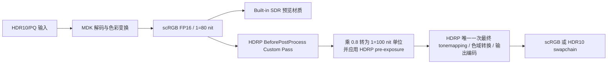
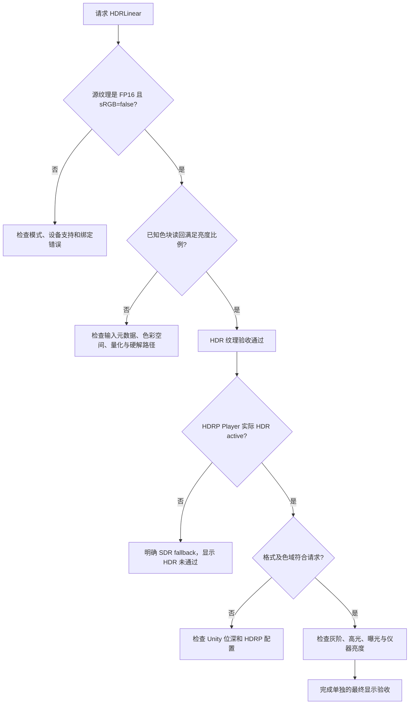

# D3D11 / D3D12 HDR 使用参考

这是可选 HDR 扩展的使用与颜色契约参考。整个插件的安装、架构和普通播放见 [项目指南](UNITY_PLUGIN_GUIDE.md)。独立 HDRP 验证工程属于实验性工具，不是主 Built-in 示例的必需依赖。

## 两种不同的验收

`MDKPlayer.OutputMode = MDKOutputMode.HDRLinear` 输出线性 HDR **纹理**，不代表当前窗口已经进入 HDR **显示输出**。默认 `SDR` 的纹理与旧 C ABI 保持兼容。

| 模式 | RenderTexture | 内容 |
| --- | --- | --- |
| SDR | ARGB32，沿用原工程 sRGB 设置 | MDK 输出 BT.709，HDR 输入在 MDK 内映射到 SDR |
| HDRLinear | `R16G16B16A16_SFloat`，sRGB=false | MDK `ColorSpaceSCRGB`：线性 Rec.709，1.0=80 nit，允许负值与 >1 高光 |

两种模式都不使用 mipmap、MSAA。HDRLinear 首轮只开放 D3D11 / D3D12。Unity 和原生设备分别检查 FP16 render/sample 支持；不满足要求明确报错，不自动降级并宣称 HDR 成功。覆盖输入为 SDR 和 HDR10/PQ；HLG、Dolby Vision、HDR10+、动态元数据透传不在本轮承诺范围。

`MDKUnityPlayerSetRenderTargetV2` 的 `structSize`、模式、纹理、尺寸、generation 一次提交。渲染线程用同一快照创建 typed RTV、设置 MDK 输出色彩空间并确认 applied generation。C# 在确认后回收旧纹理，切换模式与 resize 不会让新格式配上旧色彩空间。旧函数仍表示 SDR，`PlayerInfo` 布局未变。

## Built-in 示例：SDR 预览，不是最终 HDR 显示

选择播放器的 Output Mode 为 HDRLinear。RawImage 自动使用 `MDK/UI HDR Preview`；示例 Mesh 的 `MDK/Unlit Video` 使用 `_HDRPreview`。两个材质均用 float 采样，以 `x/(1+x)` 显式压缩到 SDR，Gamma 工程另做线性到 gamma 转换。此预览便于看见视频，不是显示器校准曲线，不改变原 FP16 纹理。自定义 Mesh 材质须自行实现预览或 HDR 合成，`MaterialPropertyBlock` 不会改变任意 shader 的行为。

Unity/Tuanjie 2022.3 的 D3D11 验收止于 HDR 纹理与 SDR 预览；不承诺 D3D11 的最终 HDR 屏幕输出。

## HDRP 验证工程

独立工程位于 `Validation/HDRPProject`，manifest 固定 HDRP **14.0.12**。它不会迁移或修改主 Built-in 示例的渲染管线。先构建插件，再准备共享源码与运行库：

```powershell
./examples/Unity/Tools/prepare-hdrp.ps1
# 团结可能将请求版本替换成内置 14.1.0。此时从已安装官方 Unity 2022.3 复制固定依赖：
./examples/Unity/Tools/prepare-hdrp.ps1 -UnityEditorRoot 'D:/path/to/Unity/Editor'
```

准备脚本会重新生成 `Assets/MDKUnity` 与 `Assets/Plugins`，不要在副本里编辑；组件及 meta 的唯一来源仍为主工程。指定 UnityEditorRoot 时复制的 embedded packages、生成场景/资产及复制的插件均忽略。准备前关闭该验证工程的编辑器。

设置 `MDK_UNITY_VERIFY_MEDIA` 为视频绝对路径，以 `-force-d3d12` 打开验证工程，执行 `MDK/HDRP/Create validation scene`。该命令生成 FP16 HDRP asset、Linear 工程设置、D3D12 图形列表、固定曝光 0 的 Volume、Neutral tonemapping、无 bloom/额外 post-exposure 的场景。没有指定媒体时先在播放器 Inspector 填写 URL。菜单提供两种构建：

- `MDK/HDRP/Build scRGB Player`：BitDepth16，预期 RGBA16F / Rec.709 / linear。
- `MDK/HDRP/Build HDR10 Player`：BitDepth10，预期 RGB10A2 / Rec.2020 / PQ。

也可用 `-executeMethod MDKHDRProject.BuildSCRGB` 或 `MDKHDRProject.BuildHDR10`。输出均在根仓库 `build/cl64/unity-hdr/BitDepth*/`。构建会检查实际解析的 HDRP 版本，拒绝把 14.1.0 当成 14.0.12。



插件事件在 camera pass 外更新视频纹理，不在 Custom Pass 内调用。Custom Pass 仅采样；不额外编码 PQ。0.8 来自 80/100：HDRP 14 HDR LUT 的输入 1 对应 100 nit，且 HDRP 场景内容遵循当前曝光乘数。固定曝光和显示器 paper-white/tonemapping 会影响最终屏幕亮度，不能把纹理中的 12.5 直接当成屏幕测得 1000 nit。原生插件不获取或更改 Unity swapchain，也不写显示 HDR 元数据。

Player 屏幕及日志 `MDK_HDR_OUTPUT` 记录请求模式、HDR available/active、实际 graphicsFormat、gamut、paper white 与显示峰值。未激活时明确显示 **SDR FALLBACK: NOT HDR DISPLAY VALIDATED**。屏幕验收需 Windows HDR 已启用且显示器可用，并检查实际状态和交换链信息；不能只看请求位深或普通 PNG 截图。

实现依据：[HDRP 14 Custom Pass](https://docs.unity.cn/Packages/com.unity.render-pipelines.high-definition@14.0/manual/Custom-Pass)、[HDRP 2022.3 UberPost 的 HDR LUT 亮度单位](https://github.com/Unity-Technologies/Graphics/blob/2022.3/staging/Packages/com.unity.render-pipelines.high-definition/Runtime/PostProcessing/Shaders/UberPost.compute)、[Unity hdrBitDepth](https://docs.unity3d.com/ja/2022.2/ScriptReference/PlayerSettings-hdrBitDepth.html)。

## 确定亮度测试片与数值验证

需要 Python 3 和带 libx265 的 FFmpeg。`FFMPEG_EXE` 环境变量或 `--ffmpeg` 指定可执行程序：

```powershell
$env:FFMPEG_EXE = 'D:/tools/ffmpeg.exe'
python examples/Unity/Tools/generate-hdr-fixture.py
python examples/Unity/Tools/generate-hdr-fixture.py --width 640 --height 360 --output build/cl64/unity-hdr/hdr10-patches-small.mkv
./examples/Unity/Tools/verify-hdr.ps1 -Editor 'D:/path/to/Tuanjie.exe' -Backend d3d11 -Decoder FFmpeg
./examples/Unity/Tools/verify-hdr.ps1 -Editor 'D:/path/to/Tuanjie.exe' -Backend d3d12 -Decoder 'D3D11:copy=0'
```

测试片为 lossless HEVC Main10 / YUV420P10，BT.2020 / SMPTE2084 / limited range。五个全高中性色块为黑、80、100、203、1000 nit；下方移动图案不覆盖采样中心。10-bit Y 量化本身有误差，期望容差为 3%。片内 VUI 与容器均写颜色标记，避免测试片被误识别成 SDR。媒体、读回和运行日志不提交。

验证读取源纹理为 RGBAFloat，检查 format、sRGB、五块 RGB，而不是读取经过预览压缩后的截图。随后测试 SDR/HDR generation 切换、暂停保留数值、停止重播、双播放器、切换到小片触发 resize，正常退出 Play Mode。可通过 `-Project` 指定 `build/cl64` 中的干净工程副本。测试时不要另开同一工程。

硬解配置只指定 `D3D11:copy=0`，不包含软件回退。还需核对 MDK 日志中的实际 `d3d11` 帧及 `DXGI_FORMAT_P010`，不能仅凭设置字符串判断启用了硬解。

## 验证状态摘要

D3D11/D3D12 的软件及 D3D11 copy=0 硬解四条路径通过了中性色块数值和生命周期检查。scRGB Player 曾报告 HDR active、FP16 和 Rec.709；HDR10 Player 仅有构建成功证据。最终屏幕亮度未完成校准，新增诊断代码后的 Player 增量构建也未完成复验。详细运行报告仅在本地保存，不随项目提交；使用前文的测试片和验证脚本复现，不将旧构建成功当作最新源码已通过。

## 显示验收：应该如何判断成功



显示验收至少记录：请求模式、实际 active、格式、色域、显示器/驱动、Windows HDR 状态、paper white、峰值来源、固定曝光与 tonemapping 配置。对两个 Player 分别执行，不能只测试编辑器 Game 视图。

普通 PNG、普通屏幕截取和 SDR 远程桌面画面只能帮助排查布局或黑屏，不能证明 203 / 1000 nit 的物理亮度正确。缺少可靠显示信息或测量条件时，应记录“输出格式已验证，亮度未验证”，不要将其合并为“全部 HDR 通过”。

## 已知边界与后续工作

- Unity/Tuanjie 2022.3 的 D3D11 本轮仅承诺 HDR 纹理与 SDR 预览。
- OpenGL/Vulkan/Metal 尚未开放 HDRLinear；HLG、Dolby Vision、HDR10+ 不在本轮验收目标。
- 团结可能替换请求的 HDRP 包版本，须检查实际解析版本；准备脚本的官方包复制选项用于固定 14.0.12。
- 当显示器峰值不可用时，HDRP 可能使用默认范围；需要独立校准，不能仅凭 active 或 PNG 宣称亮度正确。
- 当前数值测试以中性色块为主，不能完整证明广色域饱和色、暗部渐变和所有硬解驱动均正确。

通用排障见 [TROUBLESHOOTING](TROUBLESHOOTING.md)，项目改进路线见 [项目指南](UNITY_PLUGIN_GUIDE.md)，MDK 具体设计建议见 [设计资料](docs/design/MDK_UNITY_INTEGRATION_DESIGN.md)。
