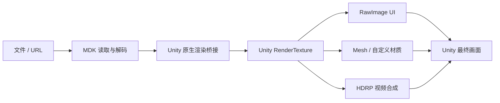
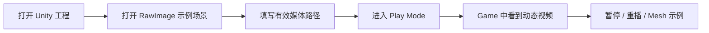
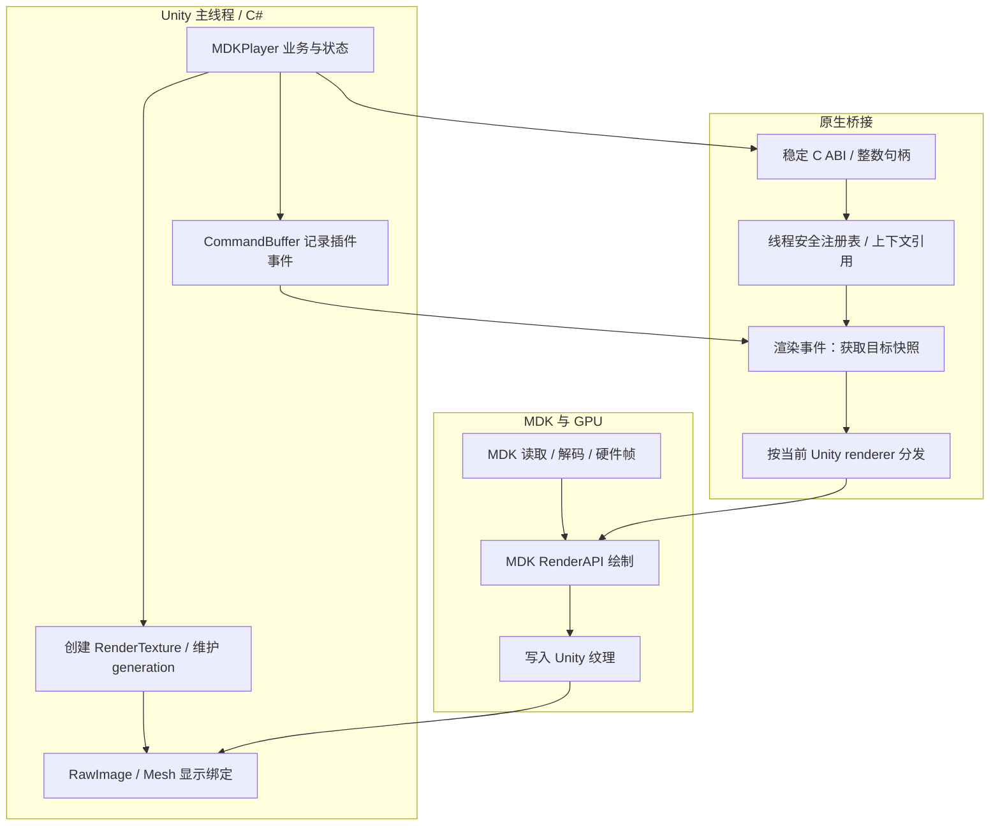
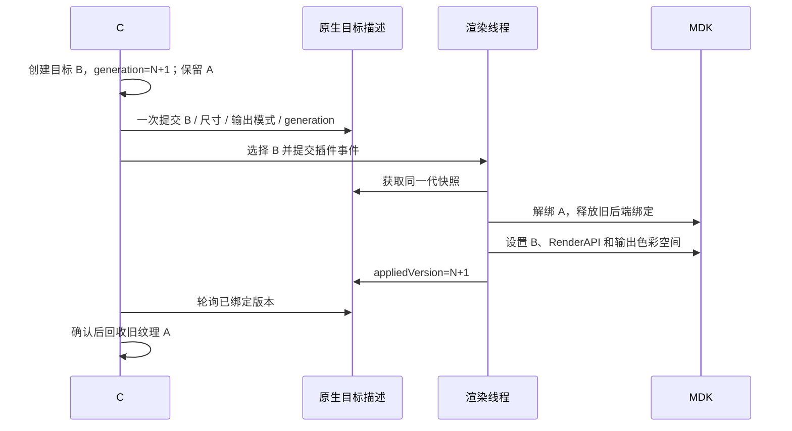
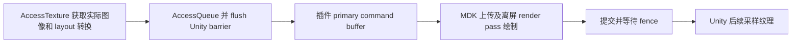
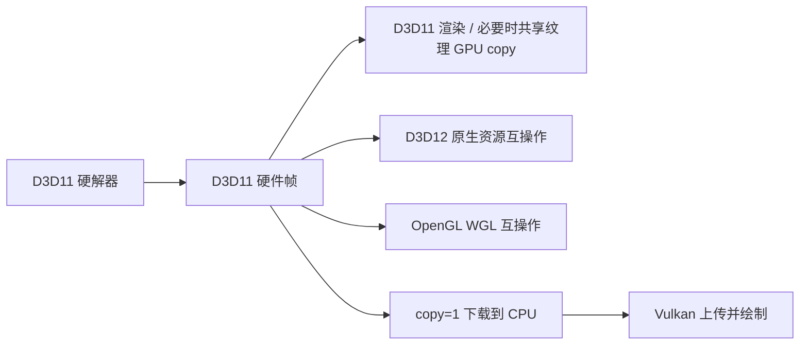
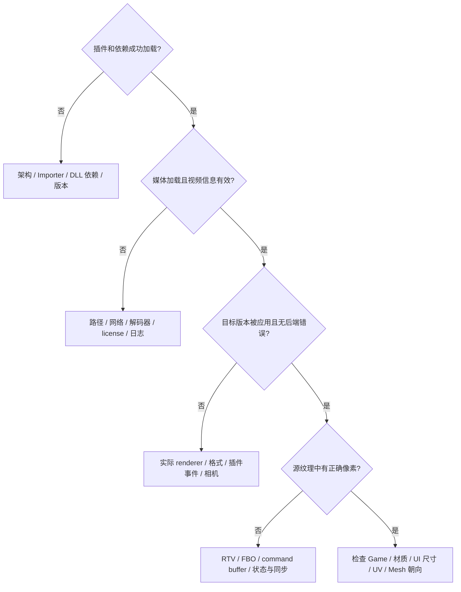
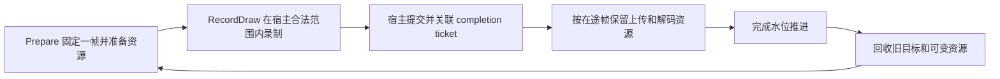

# MDK Unity 插件项目指南

使用方法 · 系统设计 · 渲染原理 · 能力与验证 · 已知问题 · 改进路线

更新日期：2026-10-24。本文覆盖整个 `examples/Unity` 项目；HDR 是其中一项扩展能力，不代表项目的全部。

> 状态约定：**已实现**表示存在相应代码；**已验证**仅指列出的环境和用例；**建议**表示尚未实现的设计。跨平台构建分支不等于跨平台实机验收，播放成功也不等于所有 GPU validation 检查通过。

## 1. 项目是什么，能解决什么问题

插件把 MDK 播放器接入 Unity：MDK 负责读取媒体、解码和视频色彩处理，Unity 原生插件在合法的图形线程中将视频绘制到 Unity 拥有的独立 `RenderTexture`，C# 组件负责播放控制和纹理生命周期。业务层可以把视频显示在 UI 或场景 Mesh 上。

与直接向操作系统窗口绘制不同，本项目把视频作为 Unity 场景中的纹理内容，不接管整个窗口。Unity 继续负责相机、UI、场景合成和最终屏幕输出。



主要能力：文件/URL 播放、播放/暂停/停止、循环设置、视频尺寸查询与自动纹理 resize、像素宽高比和旋转信息、RawImage/Mesh 显示、多播放器上下文、五类图形后端，以及 D3D11/D3D12 的可选 FP16 HDR 纹理。

不包含完整商业播放器 UI、音量/进度条、字幕 UI、DRM 方案、HDR 动态元数据透传，也没有承诺全部平台和编解码器均已验证。

## 2. 工程地图

```text
examples/Unity/
├─ Assets/
│  ├─ MDKUnity/
│  │  ├─ Runtime/
│  │  │  ├─ MDKPlayer.cs               播放、纹理和事件调度
│  │  │  ├─ MDKNative.cs               P/Invoke / 原生 ABI
│  │  │  ├─ Components/               RawImage、Mesh、基础控制
│  │  │  ├─ Resources/                HDR UI 预览 shader
│  │  │  └─ Editor/                   实际播放验证工具
│  │  ├─ Samples/                     RawImage / Mesh 场景与材质
│  │  └─ Tests/Editor/                原生加载与 ABI 测试
│  └─ Plugins/<platform>/<abi>/       本机构建插件和 MDK 运行库
├─ PluginSource/
│  ├─ RenderingPlugin.cpp             句柄、设备事件、导出函数
│  ├─ BackendDispatch.cpp             后端分发
│  ├─ RenderAPI_D3D.cpp               D3D11 / D3D12
│  ├─ RenderAPI_OpenGL.cpp            OpenGL / GLES
│  ├─ RenderAPI_Vulkan.cpp            Vulkan
│  ├─ RenderAPI_Metal.mm              Metal
│  └─ Unity/                          Unity 原生插件接口头
├─ Tools/                             构建、HDR 工程准备和验证
├─ Validation/HDRPProject/             独立 HDRP 14.0.12 验证工程
├─ Packages/                          Unity 包配置
└─ ProjectSettings/                   主示例配置
```

源码和 Unity `.meta` 应一起维护；生成插件、SDK DLL/SO、测试视频、缓存和本地日志不作为源码交付。HDRP 验证工程通过准备脚本复制共享组件，主工程 `Assets/MDKUnity` 是唯一组件源码来源。

## 3. 支持范围与实际验证

### 3.1 平台目标矩阵

| 平台 | 代码覆盖的图形 API | 本轮证据 |
| --- | --- | --- |
| Windows | D3D11、D3D12、Vulkan、OpenGL Core | 主要实机验证平台，详见下表 |
| macOS | Metal；Unity 仍提供时的 OpenGL Core | 后端源码/构建分支存在，未完成本轮实机验收 |
| Linux | Vulkan、OpenGL Core | 同上，未完成本轮实机验收 |
| Android | Vulkan、OpenGL ES 3 | 同上，未完成本轮设备验收 |
| iOS | Metal | 静态插件构建分支存在，未完成本轮设备验收 |

目标 Unity 最低版本为 2022.3。主示例使用 Built-in，以减少依赖。独立纹理与事件调度可供 SRP 接入，但示例 Built-in shader 不应被理解为任意 URP/HDRP 材质的直接替代品；SRP 材质及合成方式须匹配项目。

### 3.2 Windows 验证现状

主要环境：Tuanjie 2022.3.61t9 / 1.6.8、MSVC x64，HDR 测试使用 MDK runtime 0.38.0。运行库与当前 MDK 工作树源码并非完全同版本。

| 路径 | 状态与边界 |
| --- | --- |
| D3D11 SDR | 本轮像素变化和显示绑定回归通过；历史 `D3D11:copy=0` H.264 验证通过 |
| D3D12 SDR | 同上；渲染 API 为 D3D12，不代表使用 D3D12 解码器 |
| OpenGL Core SDR | 本轮回归通过；历史确认 D3D11–WGL 硬件帧互操作 |
| Vulkan SDR | 历史 primary + copy=1 路径曾通过 RawImage/Mesh 验证；本轮在进入 Play Mode 前发生 Unity GPU recorder 启动崩溃，不能列为当前回归通过 |
| D3D11 / D3D12 HDR 纹理 | 软件解码及唯一 `D3D11:copy=0` 硬解四组合数值与生命周期通过 |
| HDRP scRGB Player | 曾构建运行，实际报告 HDR active、RGBA16F、Rec.709；物理亮度未校准验收 |
| HDRP HDR10 Player | 曾构建成功；实际运行格式、色域和 PQ 显示尚未核验 |
| 新增 Player 诊断代码 | 源码存在，但后续增量构建失败，最新版 Player 复验未完成 |

历史成功不能覆盖当前失败，当前启动崩溃也不能在没有对照的情况下直接归因于视频插件。各次证据和日志应按时间、媒体、解码器、后端分开保存。

HDRP 验证工程与 HDR Tools 为可选、实验性资产；主 Built-in 播放不依赖它们。详细运行日志和历史验证报告仅在本地保存，不随项目提交；上表保留能力边界，复现方法见后文及 HDR 专项指南。

## 4. 从零开始：构建、部署与预览

### 4.1 前置条件

- Unity / Tuanjie 2022.3+，编辑器 license 已激活。
- CMake 3.25+、Ninja；Windows 使用 MSVC x64 开发者终端。
- MDK SDK 或当前源码树中可用的 `mdk` CMake target，及匹配平台/架构的运行库。
- Windows/Linux 构建 Vulkan 分支需要 Vulkan 头文件；Windows 可安装 Vulkan SDK。
- Android/iOS 交叉编译还需要对应 NDK/Apple 工具链与 MDK SDK；这些目标仍需单独实机验收。

主工程已移除广告、分析、购买、2D、XR 和 IDE 模板包，只保留 UI、测试及实际验证所需模块。包锁文件不随源码提交，首次打开由所选 Unity/Tuanjie registry 重新解析；这提高 registry 可移植性，但不保证跨机器传递依赖完全一致，发布时须记录实际解析清单。

精简 manifest 已在 Tuanjie 2022.3.61t9 的干净工程副本中通过 `-batchmode -nographics` 导入与 C# 编译，退出码为 0。该检查不包含 GPU 播放、Player 构建或官方 Unity registry 的单独复验；本机日志为 `build/cl64/unity-cleanup-check-import.log`。

### 4.2 Windows 推荐构建命令

从仓库根目录，在 **x64 Native Tools 开发者终端**中运行。不要直接在普通 PowerShell 中把 `call vcvars64.bat` 当作 PowerShell 命令。

```powershell
cmake -S examples/Unity/PluginSource -B build/cl64/unity-plugin -G Ninja `
  -DCMAKE_BUILD_TYPE=Release `
  -DMDK_SDK_ROOT=D:/path/to/mdk-sdk `
  -DCMAKE_INSTALL_PREFIX="$PWD/examples/Unity/Assets/Plugins/Windows/x86_64" `
  -DMDK_UNITY_INSTALL_SUBDIR=.

cmake --build build/cl64/unity-plugin --target install
```

如需复制 MDK/FFmpeg 依赖，可额外设置 `MDK_UNITY_RUNTIME_DIR` 为一个**仅包含所需运行库**的目录。安装规则会复制其中匹配的运行库，不会自动判断所有 DLL 是否适用于当前部署；不要把混放多个 SDK 版本的目录当作精确依赖清单。

也可只构建 `MDKUnityPlugin` target，手动复制插件及匹配运行库。关闭编辑器后再替换 DLL，因为 Unity 会锁定已加载的原生插件。检查 Plugin Importer 中架构和 Editor/目标平台启用状态，不能只确认文件“存在”。

公共 examples 构建提供默认关闭的 `BUILD_UNITY_PLUGIN` 入口；若宿主 CMake 已提供 `mdk` target，插件直接链接该 target，否则使用 `find_package(MDK)` 与 `MDK_SDK_ROOT`。

### 4.3 其他平台与脚本边界

`Tools/build-native.ps1` / `build-native.sh` 提供平台参数、SDK、运行库和 toolchain 入口。注意现有便捷脚本默认构建到 `examples/Unity/build/native-*`；本 checkout 的 Windows 工作约定为 `build/cl64`，因此 Windows 推荐使用上面的显式 CMake 命令，不能误认为脚本已统一目录。

| 目标 | 原生产物 / 关键条件 |
| --- | --- |
| Windows | DLL，x64，与 Unity 进程位数一致 |
| Linux / Android | SO；Android 需 NDK toolchain、ABI、API level |
| macOS | `.bundle` 后缀的插件模块；MDK 依赖和签名需检查 |
| iOS | 静态库；还需 Xcode/Unity 导出工程的链接、framework 与签名配置验收 |

脚本和 CMake 分支不是完整跨平台发布验收报告。平台 `.meta`、依赖路径、签名、架构与 SDK 许可都应在对应 Player 上核对。

### 4.4 第一次看到画面

1. 用编辑器打开 `examples/Unity`，不是 `PluginSource` 目录。
2. 打开 `Assets/MDKUnity/Samples/Scenes/MDKPlayer.unity`。
3. 在 Hierarchy 找到带 `MDKPlayer` 的对象，在 Inspector 填写 `Media Url`，首次建议使用已知有效的本地绝对路径。
4. 保持 `Output Mode = SDR`。Windows 首次建议用 `-force-d3d11` 启动编辑器。
5. 点击顶部 Play，观察 **Game** 视图。仅看 Scene 视图、听到音频或看到播放时间增长，都不能证明视频显示正常。
6. 暂停应保留末帧；停止允许清空纹理，重播后应恢复视频。退出 Play Mode 后再关闭编辑器。



预期是 UI 中的矩形视频，或场景中面向相机的 Quad 视频。Mesh 示例为 `MDKMeshPlayer.unity`，不是从边缘观察的水平 Plane。编辑器字体应保持正常；字体错位、重叠不属于正常视频缩放效果。

## 5. 业务接入与显示组件

### 5.1 播放器 API

```csharp
using MDK.Unity;
using UnityEngine;

public sealed class MyVideo : MonoBehaviour
{
    public MDKPlayer player; // 在 Inspector 绑定场景对象。

    void Start()
    {
        player.SetLoop(1); // count 交给 MDK；0 为不额外循环。
        player.Open("D:/media/video.mp4", play: true);
    }

    public void PauseVideo() => player.Pause();
    public void ResumeVideo() => player.Play();
    public void StopVideo() => player.Stop();
}
```

主要入口为 `Open`、`Play`、`Pause`、`Stop`、`SetLoop` 和 `OutputMode`。`MediaUrl` 属性仅设置字符串，播放中的媒体切换应调用 `Open`。组件当前在禁用时暂停；不要假定重新启用一定从原位置续播，应按业务要求显式控制。

查询包括视频尺寸、像素宽高比、旋转、位置/时长、renderer、错误信息及 target/applied version；`TextureChanged` 通知纹理替换，`InfoChanged` 通知查询信息更新。信息轮询不是逐视频帧回调，也不是 GPU 完成通知。

在 Unity 主线程使用这些组件 API。自定义代码不要从任意线程调用 Unity 纹理 API，也不要释放播放器仍在使用的纹理。

### 5.2 RawImage 与 Mesh

| 显示方式 | 配置 | 自动处理 | 使用边界 |
| --- | --- | --- | --- |
| RawImage | 添加 `MDKRawImageDisplay` 并绑定 player | 纹理绑定、可选宽高比/旋转、UV 翻转、HDR SDR 预览材质 | 适合 UI；检查 RectTransform 尺寸、Canvas 和可见性 |
| Mesh | Renderer + `MDKMeshDisplay` + 合适材质 | MaterialPropertyBlock 设置纹理、`_ST` UV 翻转、HDR 预览标志 | 不自动完成任意 Mesh 的几何缩放、旋转和自定义 shader 适配 |
| 自定义 SRP 合成 | 订阅纹理变更，使用管线兼容 shader/pass | 底层视频纹理可复用 | 需自行处理材质、曝光、颜色和注入位置；不能由 Built-in 示例推断全部 SRP 已验证 |

`Auto Flip Y` 按 API 纹理原点修正，`Flip Y` 是额外手工开关。新纹理到来时刷新绑定，不要永久缓存首次 `VideoTexture`。Mesh 自定义纹理属性应与 shader 中的名称一致；设置 `_HDRPreview` 不会让不认识该属性的任意 shader 自动支持 HDR。

基础 `MDKPlayerControls` 可绑定 URL InputField、播放按钮和状态 Text，不依赖 TextMeshPro。它不是包含拖动进度、音量、字幕和播放列表的完整控制台。

## 6. 总体设计与线程模型



C ABI 隔离托管和 C++ 对象布局。C# 持有整数句柄；原生注册表查找到上下文后，由回调临时持有引用，避免延迟插件事件直接访问已析构的裸指针。MDK 读取/解码有自身工作线程；GPU 目标和后端资源操作必须符合 Unity 当前渲染上下文。

`CommandBuffer.SetRenderTarget` 后提交 `IssuePluginEventAndData`，使选择目标与插件事件保持命令顺序。Built-in 将 command buffer 附到相机 `AfterEverything`；SRP 或无相机路径使用 `Graphics.ExecuteCommandBuffer`。两条路径都恢复 `CameraTarget`，不能把原生“恢复视频目标”误当成“恢复 Unity 相机目标”。

### 6.1 纹理 resize / 模式切换



`appliedVersion` 仅说明渲染线程已应用目标版本，不是所有后端通用的 GPU completion fence。当前安全性还依赖 Unity 资源提交约定、后端保留机制和 Vulkan 的显式等待，不能把它外推为独立 GPU 资源通用退役接口。

### 6.2 销毁与设备事件

销毁先标记关闭，再提交 release 插件事件，在合法渲染上下文调用 `setVideoSurfaceSize(-1,-1)` 并清理后端资源。设备 initialize/reset/shutdown 会使相关缓存失效，后续事件重建。

这不是“任何线程调用 Destroy 后所有工作立即完成”的同步接口。应用退出、脚本域重载、设备丢失和大量播放器反复创建仍需压力测试；现有冒烟结果不足以证明所有这些情形绝无泄漏或竞争。

## 7. 各渲染后端的原理

### 7.1 D3D11：显式 RTV 与状态隔离

Unity 提供设备和 `ID3D11Texture2D`。桥接层创建有效 typed RTV，不把 typeless resource format 直接当成 RTV format。绘制前后使用 D3D11 context state 隔离，避免 MDK 的 shader、混合、viewport 等状态污染 Unity UI。

“相同 RTV”不意味着“当前所有管线状态都属于 MDK”。这也是开发初期视频黑屏和编辑器文字错位需要分层排查的原因之一。

### 7.2 D3D12：资源、视图格式与命令列表

`GetNativeTexturePtr()` 返回 `ID3D12Resource*`，不是 Unity texture ID。桥接层显式提供 RTV 和 pipeline 颜色格式；现代 Unity 接口优先记录到当前 command list，旧接口保留插件列表及 `ExecuteCommandList` 路径。

目标状态由 Unity 与事件约定协作管理，并声明插件修改 command-list state，使 Unity 后续恢复自身绑定。不能把 D3D11 的全状态保存方式直接套到 D3D12。

### 7.3 OpenGL / OpenGL ES：FBO 与完整事件状态保护

在 Unity 当前 GL 上下文创建 FBO，附着原生纹理，传给 MDK 的 `GLRenderAPI::fbo`。保护范围包含初始化、上传、互操作、绘制、切换纹理与释放，而不只是最后一次 draw。

保存恢复 shader、VAO、buffer、纹理单元、viewport/scissor、blend、深度/模板和读/写 FBO 等状态，避免随后 Unity 绘制错位或黑屏。GL 对象只能在合法上下文创建和清理。

### 7.4 Vulkan：primary 兼容路径，不是当前 secondary 绘制



Unity 可能提供 secondary command buffer；MDK 当前离屏调用包含上传、barrier 和自建 render pass，不能直接在 secondary 中随意 begin/end pass。因此当前桥接通过 `AccessQueue` 提交自己的 primary，并保留玩家上下文与目标版本直到回调完成。

每次等待 fence 简化上传资源复用和纹理退役，但有 CPU/GPU 同步开销。这是正确性优先的兼容策略，不是效率最优路径。

Vulkan 硬解当前强制 **copy=1**：Windows `D3D11:copy=1`、Android `AMediaCodec:copy=1`、Linux `VAAPI:copy=1`，并有 FFmpeg 回退。支持 secondary、减少等待与支持硬解 copy=0 是三个独立课题，不能互相推断。

### 7.5 Metal：宿主设备与 command/encoder 回调

桥接层获取 Unity 的 Metal device、目标 `MTLTexture`、当前 encoder / command buffer，配置 `MetalRenderAPI` 及像素格式。资源和命令对象仍受 Unity 生命周期约束。本轮没有 Metal 实机证据，不把其他后端成功外推为 Metal 已验收。

### 7.6 硬解与渲染 API 是两条维度



`copy=0` 不代表没有任何 GPU copy，也不代表没有同步开销。历史 D3D11 测试因解码 device 与渲染 device 不同使用过共享纹理 GPU copy。验证硬解须同时确认实际 `d3d11` / P010 等帧格式与互操作日志，而不是仅看配置字符串。

## 8. SDR / HDR 与屏幕输出

| 模式 | 纹理 | 当前开放后端 | 显示方式 |
| --- | --- | --- | --- |
| SDR，默认 | ARGB32 | 五类后端的现有路径 | 常规 UI / Mesh 材质 |
| HDRLinear | RGBA16F、线性 scRGB、sRGB=false | D3D11 / D3D12 | Built-in 显式 SDR 预览，或 HDRP 合成 |

scRGB 数值 1 对应 80 nit，203 nit 与 1000 nit 的中性色块预期分别为 2.5375、12.5。源纹理保留 >1 高光；Built-in 预览使用显式压缩，不改变源纹理。

独立 HDRP 14.0.12 工程在 `BeforePostProcess` 合成，转换亮度单位并遵循曝光；HDRP 最后执行显示映射和 scRGB/HDR10 编码。插件不接管 Unity swapchain，也不额外重复 PQ 编码。

**HDR 纹理正确、HDR active、输出格式正确和屏幕实测亮度正确必须分别验收。** Unity/Tuanjie 2022.3 的 D3D11 本轮只承诺 HDR 纹理和 SDR 预览。详细配置、数学关系、测试片和逐项证据见 [HDR 专项指南](HDR_OUTPUT.md)。

## 9. 验证与排障方法

### 9.1 推荐验证层级



先定位在哪一层失败，再修复该层。有声音不证明视频解码成功；播放时间增长不证明发生绘制；绑定成功不证明内容正确；源纹理正确不证明场景显示正确。

### 9.2 运行现有验证工具

在激活 license 的编辑器中停止 Play Mode，选择 `MDK > Verify sample playback`。默认打开 RawImage 场景，读取视频纹理并检查像素变化与显示绑定；交互模式还保存 Game 截图。`MDK_VERIFY PASS` 只覆盖脚本检查项。

自动化可指定：

```powershell
$env:MDK_LOG = '1'
$env:MDK_CLOG = '1'
$env:MDK_UNITY_VERIFY_MEDIA = 'D:/media/test.mp4'
$env:MDK_UNITY_VERIFY_OUTPUT = "$PWD/build/cl64/unity-verification/d3d11"

& 'D:/path/to/Editor.exe' -batchmode -force-d3d11 `
  -projectPath "$PWD/examples/Unity" `
  -executeMethod MDK.Unity.Editor.MDKPlaybackVerification.Run `
  -logFile "$PWD/build/cl64/unity-d3d11.log"
```

这里不要加 `-nographics`，也不要用 `-quit` 提前截断异步播放验证。工具在测试完成、退出 Play Mode 后自行退出。可用 `MDK_UNITY_VERIFY_SCENE` 切换示例场景。Vulkan 的强制 `Camera.Render()` batch 路径存在编辑器深度附件问题，应使用交互验证并保留启动对照。

唯一解码器检查可在启动前设置 `MDK_UNITY_VIDEO_DECODER='D3D11:copy=0'`；非 Vulkan 不加软件回退，从日志核对真实路径。测试后移除环境变量，避免影响正常使用。Vulkan 忽略该零拷贝诊断选择，保留 copy=1 约束。

HDR 自动测试另用 `Tools/generate-hdr-fixture.py` 和 `Tools/verify-hdr.ps1`；它增加浮点数值、SDR/HDR 切换、暂停、停止重播、双播放器和媒体 resize 检查。测试读回会引入同步，不能拿这时的耗时当成正常播放性能基线。

### 9.3 已知问题与限制

| 问题 | 目前处理 / 已知边界 |
| --- | --- |
| MSVC 缺 `GL/glext.h`、min/max 宏冲突 | 原生平台封装已处理；仍报错时核对实际构建源码和旧 DLL |
| D3D11 黑屏、Unity 文字错位重叠 | 已增加 typed RTV、context state 隔离及 CameraTarget 恢复；关闭编辑器替换旧插件后复验 |
| OpenGL 有纹理但 UI/场景异常 | 已覆盖完整插件事件的 GL 状态保护；仍须结合源纹理和 Game 截图区分显示问题 |
| D3D12 resource ID 错误 | 已区分 `ID3D12Resource*` 与 Unity texture ID；不要把资源指针传给接受 texture ID 的接口 |
| Vulkan command buffer 限制 | 当前自建 primary + fence，不支持桥接层硬解 copy=0，有额外提交/等待开销 |
| Vulkan 当前启动崩溃 / validation 背景错误 | 历史成功与本轮失败并存；本轮栈在进入播放前的 Unity GPU recorder / QueryPool，需无播放启动对照，不计当前回归通过 |
| 全编辑器字体糊与重影 | DPI 缩放、Game Stretch 与 GPU 状态污染须分开诊断；不能一概改 Canvas 或归因于解码器 |
| DLL 替换后行为未变化 | 编辑器锁定或仍加载旧 DLL；检查路径、Importer 和二进制版本，重启再验 |
| Corrupted Library 阻塞启动 | 保留用户缓存，在 `build/cl64` 干净副本验证；不自动删除整个用户工程缓存 |
| HDRP 包版本替换 | 团结可能解析为内置 14.1.0；准备脚本可固定官方 14.0.12 依赖，构建会核对实际版本 |
| HDRP shader OOM / Bee 增量构建崩溃 | 早期两个 Player 有成功构建，但后续诊断版未复验；需隔离并限制并行、检查提交内存和工具链 |
| macOS/Linux/Android/iOS 与 SRP 完整矩阵 | 目前没有足够本轮实机验收证据，不能从 Windows/Built-in 结果外推 |
| 设备重置、域重载和长期压力 | 有设备事件和生命周期实现，但未完成覆盖全部设备/驱动的压力验收 |
| Mesh 自动方向/尺寸 | 当前主要处理绑定和 UV；自定义几何宽高比、旋转、可见性由显示层负责 |

更详细的故障步骤见 [TROUBLESHOOTING.md](TROUBLESHOOTING.md)。

## 10. 开发中得到的设计经验

1. **宿主状态是显式责任。** MDK 绘制成功后，Unity 的相机目标和管线绑定仍必须正确，否则视频可能正常而整个 UI 被污染。
2. **resource format 不等于 view format。** typeless 资源需要明确的 RTV/FBO/pipeline 格式约定，不能仅凭纹理指针推断颜色语义。
3. **命令对象类型是契约，不是细节。** Vulkan primary/secondary、render pass 内外、D3D12 command list、Metal encoder 都限制允许记录的操作。
4. **绑定确认不等于 GPU 完成。** 延迟回调的 CPU 对象寿命和在途 GPU 资源寿命需要分别管理。
5. **实际路径比请求配置更重要。** 硬解名称、copy 模式和 HDR 位深只是请求；应检查实际帧、互操作、输出格式与状态。
6. **测试必须穿过 Unity 显示层。** 单独 MDK 原生测试不能证明 CameraTarget 恢复、UI 绑定、UV 或屏幕输出正确。

## 11. 可改进的地方：项目层与 MDK 层

以下均为待实现建议，不是当前接口承诺。收益为架构预期，没有基准数据支持具体 FPS 或百分比提升。

### 11.1 优先级与交付收益

| 优先级 / 层 | 建议 | 实现要点 | 收益与验收 |
| --- | --- | --- | --- |
| P0 / 项目 | 统一构建目录与精确依赖部署 | 脚本支持 build root；Windows 默认 cl64；用清单复制匹配运行库并记录版本/hash | 降低 DLL 混用和“改了未生效”；干净机器可复现构建 |
| P0 / 项目 | 分层机器可读诊断 | 查询/报告实际 decoder、帧格式、renderer、视图格式、目标代数、错误阶段；汇总测试 JSON/文本报告 | 减少有声音无画面的人工排查；明确 FAIL 与 NOT VERIFIED |
| P0 / MDK | D3D11 状态保存判据与 typed 格式解析 | 审计相同 RTV 时跳过保存的逻辑；视图格式显式优先，拒绝无法推断的格式 | 减少 UI 污染、黑屏和桥接特例；用预置宿主状态和格式组合回归 |
| P0 / MDK | D3D12 显式格式优先 | 避免 typed pipeline format 被 typeless resource format 覆盖；明确 barrier 所有权 | 减少特殊回调绕过；资源、视图、pipeline 三者可同时正确描述 |
| P1 / MDK + 桥接 | 完成票据与延迟回收 | 区分 bound generation、submitted serial、completed serial，按 GPU 完成释放资源 | 降低 resize/退出时竞态，为减少等待提供安全基础 |
| P1 / MDK | Vulkan Prepare / RecordDraw 分离 | pass 外上传和 barrier；宿主 pass 内只 draw，校验 command level/pass 兼容性 | 有机会复用 Unity secondary、减少额外提交/flush；保留当前 primary 回退 |
| P1 / 项目 | 跨平台与 SRP 矩阵 | 每目标构建和 Player 冒烟；Built-in/URP/HDRP 分开验收 | 把“代码覆盖”逐步转为“设备验证”，及早发现 importer/签名/接口差异 |
| P1 / 项目 | 完成 HDRP 与显示验收 | 重建最新版诊断 Player，核对两种输出，并增加显示校准 | 不混淆源纹理正确与屏幕亮度正确 |
| P2 / MDK | 解码 device 协商 | 审计现有属性与缓存，协商能否借用宿主兼容设备，报告未采纳原因 | 条件允许时减少跨 device GPU copy；不能强制使用无解码能力的设备 |
| P2 / 项目 | 显示组件与播放控制完善 | 明确 Mesh 比例/旋转约定；增加进度、音量等业务 UI；提供 SRP 材质样例 | 更易直接接入实际产品，减少重复几何和 shader 适配 |
| 独立任务 | Vulkan 硬解 copy=0 | 分平台验证外部内存、格式、设备、同步与解码表面寿命 | 可能减少 CPU 下载/上传，但不因 secondary 支持而自动获得 |

### 11.2 建议的未来录制与回收模型



建议把设备绑定、目标描述、每次录制范围与完成信号分离；新增描述使用带尺寸/版本的稳定 C ABI，不直接扩展旧无尺寸结构后假设二进制兼容。Unity 专有接口仍留在桥接层，通用的格式校验、资源退役和渲染契约放在 MDK。

不要直接删除 Vulkan fence 等待来优化性能：在没有在途资源池和完成协议前，这会把可见开销变成数据竞争。应先建立正确性基线，再分别测 CPU 录制时间、GPU 时间、copy 字节、提交次数、等待分位数和端到端延迟。

## 12. 验收清单与文档索引

发布或合并前建议逐项记录，不因已有单次播放成功而勾选所有项：

- [ ] 目标平台、架构、SDK/插件版本和运行库清单一致。
- [ ] 实际后端与请求一致，源纹理有正确且持续变化的内容。
- [ ] RawImage / Mesh 的方向、比例、可见性和材质正确。
- [ ] 软解与硬解分开测试，确认实际帧及互操作路径。
- [ ] 暂停、停止重播、resize、切媒体、双播放器与退出通过。
- [ ] reset、域重载、长期压力和 GPU validation 有独立记录。
- [ ] 各 SRP 与各平台 Player 的结果单独记录。
- [ ] HDR 纹理、实际显示格式和物理亮度分别验收。
- [ ] 失败/未验证项保留，日志和截图未作为源码二进制提交。

| 文档 | 作用 |
| --- | --- |
| 本文 | 整个插件项目的使用、架构、原理与现状总览 |
| [README](README.md) | 简短入口与后端列表 |
| [故障排查](TROUBLESHOOTING.md) | 黑屏、状态污染、后端与验证操作 |
| [HDR 专项指南](HDR_OUTPUT.md) | FP16、亮度单位、HDRP、数值证据和显示边界 |
| [MDK 集成改进设计](docs/design/MDK_UNITY_INTEGRATION_DESIGN.md) | MDK 源码问题定位、拟议契约和实施细节 |
| [Vulkan 专项改进](docs/design/MDK_VULKAN_IMPROVEMENTS.md) | secondary/primary、同步与性能改进边界 |

本轮总览依据本项目源码和已有验证记录整理，没有为撰写本文重新运行全平台测试，也没有把建议中的 MDK API 当作已实现能力。
