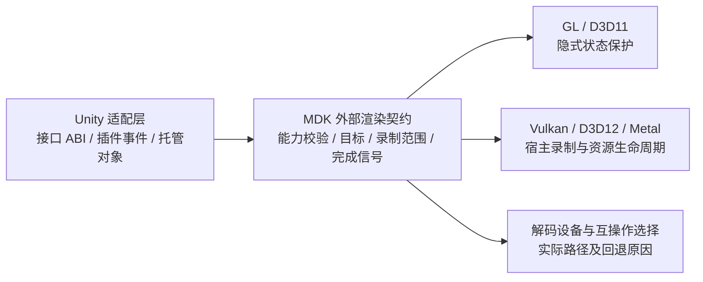
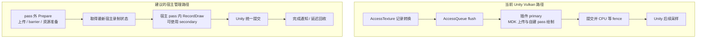
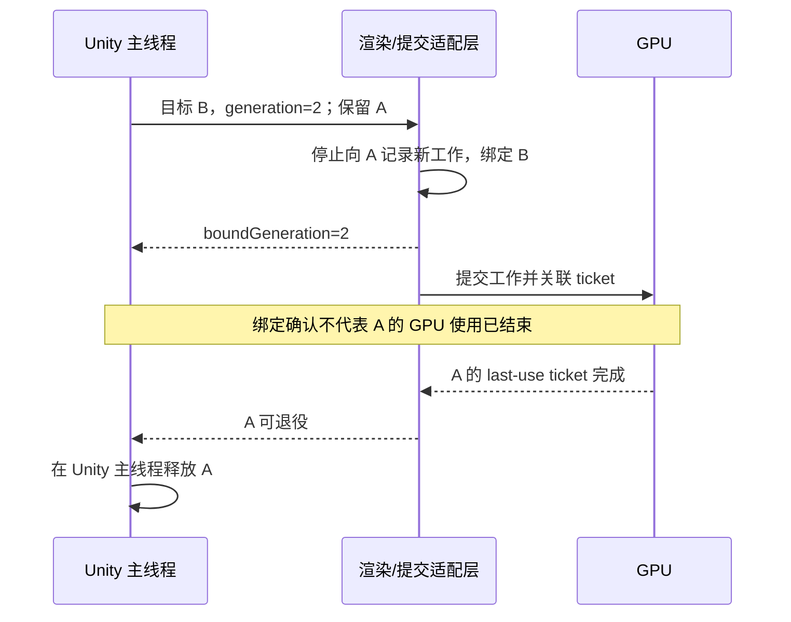

# MDK 与 Unity 集成：开发复盘、库改进与实现设计

本文基于本示例的开发、源码检查和 Windows 实机验证，说明哪些问题应由插件修正，
哪些能力适合下沉到 MDK，以及如何在保持兼容性的前提下降低接入成本和运行开销。
文中的新接口名称均为设计示意，尚未实现或确定为公共 API。

## 1. 结论与验证边界

最值得优先投入的方向有三项：

1. 修复外部目标格式推断和 D3D11 状态保存中的具体问题，使“传入 Unity 纹理即可绘制”更可靠。
2. 为外部渲染建立统一契约，明确设备、目标、命令录制、状态和 GPU 完成的责任归属。
3. 在此基础上拆分 Vulkan 的上传与绘制，并按在途帧管理资源，逐步减少额外提交和 CPU 等待。

这不要求把 Unity 依赖放进 MDK 核心。Unity 接口版本、插件事件、场景显示和
托管对象仍由桥接层处理；格式处理、绘制资源、帧完成协议和可观测性应尽量成为
可复用的 MDK 能力，也能用于 Qt、其他游戏引擎和自定义渲染器。

当前已经完成的是桥接层修复和验证，不是下述 MDK 核心改进。
实机验证环境为 Windows、Tuanjie 2022.3.61t9，测试视频为 H.264 1920×1080。
不能据此宣布 macOS/Metal、Linux、Android/iOS、全部编解码器或所有 SRP 已经验证。

| 已验证组合 | 结果和证据边界 |
|---|---|
| D3D11 渲染 + `D3D11:copy=0` | 硬件帧格式为 `d3d11`，画面变化且退出码为 0；因设备不同使用了共享纹理 GPU 拷贝 |
| D3D12 渲染 + `D3D11:copy=0` | 原生 GPU 资源互操作，画面变化且退出码为 0；不是 D3D12 解码器验证 |
| OpenGL Core + `D3D11:copy=0` | 确认 D3D11–WGL 互操作，画面变化且退出码为 0 |
| Vulkan + `D3D11:copy=1` | 确认硬解拷回，RawImage、Mesh 画面正确且正常退出 |

`copy=0` 表示解码器输出硬件帧，不保证渲染链路完全没有 GPU 拷贝或格式转换。
上述 `copy=0` 测试只选择一个解码器，未配置软件解码回退；日志同时核对了实际输出格式和互操作路径。
测试中的 `ReadPixels()` 用于验收输出，不能把这次主动读回当作视频渲染路径的性能数据。

## 2. 开发中遇到的问题及归属

| 现象/问题 | 已确认原因或处理方式 | 应落在哪一层 |
|---|---|---|
| MSVC 缺少 `GL/glext.h`、`std::min/max` 编译报错 | Windows 扩展函数加载和 Windows 宏冲突；桥接层已处理 | 插件构建与平台封装 |
| 崩溃、调用了错误的 Unity 后端接口 | 需要按实际 renderer 查询接口，严格保持官方接口 ABI | 插件；不是 MDK 解码/渲染故障 |
| Vulkan 接口调用错位 | `Instance()` 返回值声明错误，接口中遗漏函数槽 | 插件 ABI 错误，已修正 |
| 有声音，无视频；Unity UI 文字错位/重叠 | 外部图形状态受到影响；桥接层增加 D3D11 context-state 隔离、GL 状态恢复，并恢复 Unity 相机目标 | 插件必须恢复自己的状态；MDK 的外部状态契约和 D3D11 保存器也可改进 |
| D3D11 typeless 目标黑屏 | 桥接层创建明确格式 RTV 后正常 | MDK 自动创建视图的路径有可定位改进点，见第 3 节 |
| D3D12 大量 `Resource ID out of range` | 把 `ID3D12Resource*` 错当作 Unity texture ID | 插件错误；不能由 MDK 猜测修复 |
| D3D12 目标格式/管线不匹配 | 桥接层显式提供 typed RTV 和颜色格式，避开 typeless 资源格式推断 | MDK 格式优先级和资源状态契约可改进 |
| Vulkan 有画面但 validation 报 secondary 开启 render pass 非法 | Unity 提供 secondary，MDK 离屏路径自行 begin/end render pass | 集成能力不匹配；当前用插件 primary + `AccessQueue` 适配 |
| Vulkan 每次绘制后 CPU 等待 GPU | 当前桥接层使用 fence 保证上传资源复用和纹理回收安全 | 桥接层当前的安全策略；需要 MDK 完成协议才能减少等待 |
| 硬解是否真的生效不明确 | 默认选择和缺少详细日志不足以证明 `copy=0`；后续改为显式单一解码器验证 | MDK 可提供结构化运行状态，插件负责展示 |
| 视频倒置、Mesh 不可见 | API 坐标原点差异、水平 Plane 被沿边观察、材质缺少照明 | 显示组件/示例问题；不能归因于解码失败 |
| 验证播放结束后退出异常 | 测试脚本过早请求退出；改为等待进入 Edit Mode | 验证工具；不能直接推断为 MDK 析构缺陷 |
| Vulkan 校验仍有 swapchain 报错 | 部分错误在未进入 Play Mode 的对照启动中也复现 | 当前编辑器的背景问题，验收时须独立归类 |

原则是保留证据层次：画面正常不等于没有非法 GPU 命令；配置了硬解不等于实际用了硬解；
桥接层规避问题成功也不等于已经完成 MDK 核心修复。

## 3. 可优先修复的 MDK 源码问题

### 3.1 D3D11：不能以“RTV 相同”推断管线状态属于 MDK

源码位置：`video/d3d/D3D11Video.cpp` 的 `D3D11StateSaver`。
它在 `rtv` 为空或当前 `rtvs_[0] == rtv` 时跳过其余状态保存。
Unity 恰好会先绑定视频目标，再执行插件事件；相同 RTV 不意味着 shader、
blend、viewport、sampler 等状态由 MDK 管理。该启发式不适合作为外部上下文的判据。

建议修复：用显式的上下文所有权/状态策略替代这个判断。外部上下文进入状态保护时，
即便 RTV 相同也必须保护约定范围；内部独占上下文可以免除保护。保存范围还应审计
深度/模板、shader class instances、各阶段绑定及互操作初始化涉及的状态，
不能只移除一个 early-return 就宣布完整支持 Unity。

桥接层目前通过 `ID3D11DeviceContext1::SwapDeviceContextState()` 隔离绘制。
MDK 可将这种方式作为受支持设备上的实现，并为不支持该接口的设备保留明确的
手动保存路径或返回不支持。不能无声退回到不恢复状态的绘制。

收益：降低 UI 污染和依赖调用顺序的偶发问题，多个外部框架无需重复写保护代码。
完整状态保护有成本，应提供安全模式与宿主管理模式，而不是对所有内部播放路径无条件启用。

### 3.2 D3D11：typeless 资源不能直接作为 RTV 格式

源码位置：`D3D11Video::set()` 中从 `ID3D11Texture2D` 自动创建 RTV 的分支。
当前 `D3D11_RENDER_TARGET_VIEW_DESC::Format` 直接取资源 `desc.Format`，
源码仍保留 `TYPELESS => UNORM/FLOAT` 的 TODO。公共接口允许传入纹理，
因此此路径需要对 Unity 常见 typeless 资源给出有效处理或清晰错误。

建议实现一个共享的视图格式解析器：

1. 调用者提供视图时，使用视图格式并校验资源兼容性。
2. 调用者提供明确的 typed 颜色格式时，优先采用该格式并校验用途/支持情况。
3. 仅在语义明确的兼容模式下对已知格式族选择默认视图，并记录解析结果。
4. 对无法确定的格式返回 `TargetFormatRequired` 等错误，不把 typeless 交给 RTV/PSO 创建。

尤其不能仅凭 typeless 判断应使用 UNORM 还是 sRGB；两者影响颜色含义。
解析器还要处理纹理数组、mip、采样数和视图维度。当前示例的 SDR 8-bit 映射不代表完整格式支持。

收益：简单纹理接入路径更接近接口文档的使用体验，消除“纹理有效但一直黑屏”的常见原因。

### 3.3 D3D12：显式视图格式应优先于资源格式

源码位置：`video/d3d/D3D12Video.cpp` 的 `D3D12Video::render()`。
当前先取配置的 `pd_fmt`，但当 `rt` 非空时又用 `rt->GetDesc().Format` 覆盖，
随后创建 pipeline。typeless 资源与 typed RTV 的组合下，资源格式不能代替有效视图格式。

建议修复：复用上述格式解析规则；已知 typed 颜色格式优先，用资源格式作兼容性校验和
没有显式信息时的推断。`colorFormat`、RTV、资源句柄应能同时提供，不应要求用户通过
让目标回调返回空指针来保留正确的 pipeline 格式。D3D12 descriptor handle 本身不能
查询出完整视图描述，所以宿主提供颜色格式是合理契约的一部分。

同时明确资源状态的所有权：宿主管理时只记录绘制，不擅自转换目标；MDK 管理时要求
输入/输出状态并记录必要 barrier。当前绕过方式不能代替这一接口定义。

收益：减少特殊回调组合、格式不匹配和错误 barrier，明确外部 command list 的行为。

## 4. 统一外部渲染契约

现有 `RenderAPI` 已提供设备、目标和部分 command buffer 回调，适合继续复用；
需要完善的是各后端共有的所有权、合法操作范围、失败原因与完成语义。



建议把“长期设备信息”“可变目标”“每次录制的临时信息”分开描述：

| 描述对象 | 关键字段/约定 | 生命周期 |
|---|---|---|
| DeviceBinding | 后端、设备标识、队列/上下文、设备 epoch、可选能力 | 设备 initialize 到 shutdown |
| TargetBinding | 资源/视图、typed 格式、尺寸、samples、mip/layer、颜色含义、generation | 纹理创建/替换到安全退役 |
| RecordingScope | 当前命令对象、command level、pass/subpass、状态策略、frame serial | 仅本次回调有效 |
| PreparedFrame | 视频帧引用、已准备资源、目标兼容信息 | 准备成功到提交完成/取消 |
| CompletionTicket | 提交序号、完成域、完成状态、待回收资源 | GPU 完成后可回收 |

状态策略可以表达三种不同责任：

- `PreserveState`：GL/D3D11 安全接入，MDK 保护其会修改的宿主状态。
- `HostInvalidatesState`：宿主能在插件后重新绑定状态，MDK 明确报告其修改范围。
- `ExclusiveContext`：独占上下文，免去不必要的查询/恢复。

D3D12/Vulkan 不应承诺通用的“自动保存并恢复任意 command buffer 状态”。
这类后端需要宿主配合恢复绑定，例如 Unity 的 modifies-command-state 标志。
GL 保护必须覆盖初始化、上传、互操作、纹理替换和释放，不只是最终 draw。

SDK 应提供通用 helper 和契约测试；Unity 专有的 `ConfigureEvent`、`AccessTexture`、
`AccessQueue` 仍留在适配层，不放入通用 MDK 库。

## 5. Vulkan：分离准备与绘制，保留可靠的兼容路径

`VulkanRenderAPI` 已有 `render_pass`、`beginFrame`、`currentCommandBuffer` 等回调，
`VulkanVideo::render()` 也存在不主动 begin/end pass 的分支。问题不是从零增加
“外部 render pass 支持”，而是将其做成可以校验、可以安全使用的完整路径。

当前 `VulkanVideo::render()` 在一次调用中执行纹理上传、barrier、资源更新和绘制。
单纯跳过 begin/end pass，仍不能保证剩余命令可以放进宿主正在执行的 pass。



建议的逻辑操作如下，名称只表示职责，不是已确定的 API：

1. `Prepare`：选择并保留一帧，进行上传、映射和资源准备，返回 `PreparedFrame`。
2. `RecordDraw`：使用本次 `RecordingScope` 记录合法的 draw；不切换宿主附件或提交队列。
3. `OnSubmitted`：宿主为本次使用关联完成票据；准备了但没有提交的帧走取消路径。
4. `CollectCompleted`：按宿主完成水位或自己的 fence 回收资源。

`PreparedFrame` 必须固定同一视频帧，避免两个阶段之间解码推进造成纹理和参数不对应。
Unity 资源访问可能使 recording state 失效，不能把准备阶段拿到的句柄长期缓存给绘制阶段。
宿主 pass 的 subpass、采样数、颜色格式和深度附件等必须纳入 pipeline 兼容信息。

实施时须覆盖字幕、叠加和分层视频，不能只拆出主视频的一次 draw。
Dynamic rendering 可以独立扩展，不作为 Unity 2022.3 基础路径的要求。

当前 `AccessQueue` + primary 方案应保留，作为旧 MDK/旧 Unity 或能力不足时的回退。
拆分成功后，再根据验证结果允许走宿主 secondary 路径；不能只根据 renderer 名称启用。
进一步分析见 [Vulkan 专项说明](MDK_VULKAN_IMPROVEMENTS.md)。

## 6. 统一完成协议与资源退役

### 6.1 区分 CPU 完成与 GPU 完成

当前 `appliedVersion` 表示桥接层已应用纹理版本，不能将它泛化为所有后端的
“GPU 已完成旧纹理使用”。Vulkan 当前依靠每次提交后的等待补足安全条件；
其他后端仍涉及 Unity 的资源保留和提交约定。

建议分别提供：`boundGeneration`、`lastSubmittedSerial` 和 `completedSerial`。
旧纹理只有在不再产生新引用、最后一次 GPU 使用已完成，且宿主允许释放后才能退役。



### 6.2 为在途帧分配独立可变资源

审计上传/staging buffer、uniform/vertex buffer、descriptor、command allocator/pool、
临时 framebuffer/image view 和硬解表面引用。资源在最后一次提交完成前不得覆盖或释放。
采用按帧资源池和延迟回收队列；池满时明确选择等待或丢弃待呈现帧，而不是无限增长。

Unity 的 safe-frame 信息只用于其定义范围内的工作；插件自行提交的 Vulkan 工作
必须跟踪自身 fence。多个不同完成域不能只用一个不带来源的帧编号比较。

完成协议建立后，才可将 Vulkan 的“每次提交立即等待”改为“复用槽位时必要才等待”。
同一队列提交有顺序也不意味着所有内存访问已同步，仍须正确设置 barrier 和访问范围。

### 6.3 销毁与设备重置

建议定义 `Active → Closing → GPUDrained → Released` 的关闭状态机：
先拒绝新绘制，再处理已排队回调，等待相关 GPU 使用完成，然后在合法设备线程释放
渲染资源，最后结束解码和释放播放器。所有权通过整数句柄和受控上下文管理，
待执行回调持有上下文引用，不能携带已经释放的裸指针。

若 CPU 析构需要后台执行，应有受管理的销毁队列和卸载时的 drain，避免 detached
线程在插件/MDK DLL 卸载后继续执行。不能在持有 registry 全局锁时等待需要访问该锁的回调。
设备重置递增 epoch，使旧目标、prepared frame 和 command buffer 立即失效；
旧 completion ticket 仍须按其设备生命周期终结，不能误用新设备的计数器。

收益：集中解决 resize、退出 Play Mode、域重载和多播放器的释放问题，减少各后端独立猜测。
这套设计需要专门压力验证，现有启动/播放冒烟测试不足以证明其已经正确实现。

## 7. 解码设备选择与可观测性

### 7.1 减少不必要的跨设备 GPU 拷贝

本次 D3D11 `copy=0` 日志显示解码设备与 Unity 渲染设备不同，因此创建共享纹理并做 GPU 拷贝。
这不代表硬解失效，却说明只指定相同 GPU/adapter 还不一定复用了同一个 device。

先审计现有解码器属性、设备缓存和 native buffer 接口能否复用宿主设备；
再考虑提供稳定的“解码设备偏好/借用设备”扩展。输入需包含 adapter 标识、设备引用及线程要求，
输出必须告知是否采纳和原因。Unity 的 D3D11 device 不一定有视频解码所需能力，
因此应区分“偏好复用”与“强制复用”，不能为了少一次 copy 使用不合法的设备。

缓存键应覆盖设备身份、epoch、格式、尺寸及共享策略；设备重置或解码配置变化时失效。
不同设备/adapter 需要不同共享和同步机制，不能只比较裸指针地址来跨生命周期复用。

### 7.2 把真实运行路径变成结构化信息

建议提供每播放器/渲染目标的可查询快照或低频变更事件：

| 信息 | 建议内容 |
|---|---|
| 解码 | 请求/实际解码器、软硬解、实际输出像素/硬件帧格式 |
| 互操作 | 直接采样、GPU 共享/拷贝、CPU 拷回、回退原因 |
| 设备 | 解码与渲染 adapter/device 标识及是否一致 |
| 渲染 | 后端、资源格式、有效视图格式、目标 generation、最近成功帧序号 |
| 同步 | 在途数量、提交/完成序号、等待次数和耗时 |
| 错误 | 阶段、稳定错误码、原生错误码、目标版本和简短说明 |

例如 `UnsupportedTargetFormat`、`InvalidCommandScope`、`InteropUnavailable`、
`DeviceLost` 应能区分，避免仅得到“backend unavailable”或持续黑屏。
调试错误应在第一次不合法调用时返回，不等到驱动崩溃才排查。

现有 `renderVideo()` 的时间戳返回值和首帧事件应保留兼容性，但它们不能独立证明
发生了新绘制或 GPU 已完成。可增加结果扩展：`NoFrame / Reused / Recorded / Failed`、
视频帧序号和 completion ticket。持续画面测试仍应读回或截图验证，不能仅检查非负时间戳。

## 8. 颜色、尺寸和显示方向的边界

MDK 可以统一给出像素宽高比、旋转、可见区域、输出颜色信息与纹理原点约定，
减少每个桥接层重复推断。必须区分“MDK 已在绘制中应用旋转”与“显示端还需旋转”，
以及视频编码尺寸、可见尺寸和实际目标尺寸，避免重复旋转或宽高比计算错误。

Unity 的 Quad/RawImage 选择、材质、UV 翻转和 CameraTarget 恢复仍由显示层负责。
本示例的 SDR ARGB32 验证不能自动扩展成 HDR/sRGB/线性色彩空间正确性的证明；
后续格式支持应使用明确的目标颜色描述和测试图验收，而不是对所有 typeless 纹理默认 UNORM。

Metal 虽已有 `currentCommand` 回调，也应使用同样的 encoder/pass 所有权和完成协议，
但本次没有 Metal 实机证据，不能把 Vulkan 的现象直接断定为 Metal 缺陷。

## 9. API 兼容性与实现方式

优先修复现有实现：D3D11 保存器判据、格式解析、D3D12 显式格式优先级和错误日志，
不必先重做全部公共 API。

需要新增能力时建议使用有 `struct_size`、版本和 capability bits 的扩展接口，
以稳定 C ABI 表达，C++ 只做薄封装。统一接口承载通用生命周期，各后端保留自己的
资源/录制描述。示意操作如下：

```text
QueryIntegrationCapabilities(device) -> capabilities
ValidateTarget(device, target)        -> result
Prepare(frameScope)                   -> preparedFrame
RecordDraw(preparedFrame, scope)      -> recordResult
NotifySubmitted(recordResult, ticket)
CollectCompleted(completionDomain, completedSerial)
CloseTarget(generation)               -> retirement status
```

不要直接给既有未带尺寸字段的 C/C++ 结构追加成员，并假定旧二进制可以读取；
也不能仅看到 `reserved` 就在未经版本协商时解释为新指针。需要审计
`include/mdk/RenderAPI.h`、`c/include/mdk/c/RenderAPI.h` 及转换代码，确保两层对应。
能力查询失败时走现有回退，不能强制要求旧 SDK 支持新的宿主 pass 路径。

快照查询只复制已发布的状态；渲染回调不应长期等待主线程锁或执行 Unity 主线程 API。
错误使用错误码/结果对象传播，保持库无异常、无 RTTI 的构建要求。

## 10. 收益、成本和落地优先级

| 优先级 | 改动 | 预期收益 | 成本/主要风险 |
|---|---|---|---|
| P0 | 修正 D3D11 状态保存、typed 格式解析、D3D12 格式优先级 | 减少 UI 污染、黑屏和特殊参数组合 | 需保留内部渲染快速路径，防止颜色语义或既有用户行为变化 |
| P0 | 目标预检、能力和结构化诊断 | 更早定位错误，减少“有声音无画面”的排查成本 | 需要统一错误码和明确实际互操作统计 |
| P1 | 完成票据、在途资源池、统一退役协议 | 安全减少 CPU 等待，降低 resize/退出时释放风险 | 涉及全部后端的资源审计和多线程验证 |
| P1 | Vulkan 准备/绘制拆分与宿主 pass 支持 | 有机会省掉额外提交/flush，保留 Unity 的并行录制调度 | 需覆盖字幕/分层路径及 pipeline/pass 兼容性 |
| P2 | 解码设备协商与设备身份缓存 | 条件允许时减少跨 device GPU 拷贝 | 宿主 device 不一定支持解码，跨 GPU 和重置情况复杂 |
| P2 | 统一颜色与可见区域描述、官方适配 helper | 减少重复翻转/比例错误及桥接重复代码 | 需避免与现有旋转/色彩处理重复应用 |
| 独立项目 | Vulkan 硬解零拷贝 | 特定平台可能减少 CPU 拷回和上传 | 外部内存、格式、设备匹配、队列同步、解码表面寿命均需独立验证 |

Vulkan 当前保持 `copy=1`。支持 secondary、移除 CPU 等待和硬解零拷贝是三个不同目标，
前两项完成后不能自动切换到 `copy=0`。各平台应分别建立能力矩阵和回退条件。

收益目前是架构预期，没有基准数据支持具体的 FPS、延迟或百分比承诺。
低风险修复的首要收益是正确性；性能收益应以同条件测量确认。

## 11. 验收和性能评估

分阶段交付，每一阶段保持当前插件回退路径可用：

1. **核心正确性修复**：同一 RTV 下预置非 MDK shader/混合/深度等状态，验证调用后恢复；
   验证 typeless + 显式 typed 视图、UNORM/sRGB、数组/mip，以及非法组合的确定错误。
2. **外部完成协议**：至少覆盖 2–3 个在途帧、旧目标仍被 GPU 使用时 resize、
   重复关闭、设备 epoch 变化和两个播放器交错提交；检查无提前复用和释放。
3. **Vulkan 宿主绘制**：primary 离屏和 secondary 宿主路径都要验证；
   检查准备阶段的上传和 barrier，以及绘制阶段没有非法 begin/end pass 或队列提交。
4. **运行行为**：播放、暂停保留最后帧、停止/重播、媒体切换、域重载、进入/退出 Play Mode、
   设备重置和应用退出；分别验收 Built-in/URP/HDRP，而不是由一个示例推断全部支持。
5. **硬解矩阵**：分别记录 decoder 与 renderer，检查实际硬件帧和互操作路径；
   覆盖 H.264、HEVC、8/10-bit、不同 adapter/厂商，不能把 D3D12 渲染等同于 D3D12 解码。

性能测试固定媒体、分辨率、adapter、解码器、copy 模式和帧率，区分冷启动与稳定播放。
记录 CPU 准备/录制耗时、GPU 绘制耗时、队列提交次数、CPU/GPU 等待、上传/拷回字节、
在途资源峰值和端到端显示延迟。测试读回会增加同步，应与性能采样分开。
报告平均值及分位数，并把差异归因到具体改动；不要只比较 FPS。

GPU validation 应与未播放视频的编辑器对照比较，保留新增错误列表；
对照已有错误不等于可以忽略所有后续同名错误，仍需检查对象和发生阶段。
Windows 编译和本地验证产物放在 `build/cl64`，GPU 测试在可访问实际设备的环境运行。

## 12. 源码与验证索引

| 路径 | 作用 |
|---|---|
| `include/mdk/RenderAPI.h`、`c/include/mdk/c/RenderAPI.h` | 现有渲染接口和 ABI |
| `video/d3d/D3D11Video.cpp` | 自动 RTV 创建、D3D11 状态保存和绘制 |
| `video/d3d/D3D12Video.cpp` | 格式选择、pipeline、上传及 command list 绘制 |
| `video/vulkan/VkVideo.cpp`、`video/out/VkVideoRenderer.cpp` | Vulkan 准备/绘制和外部回调适配 |
| `video/interop/D3D11BufferPool.cpp` | D3D11 硬件帧到 GL/D3D 等路径的设备共享和映射 |
| `examples/Unity/PluginSource` | 当前已验证的 Unity 桥接与状态/同步适配 |
| `examples/Unity/Assets/MDKUnity/Runtime/Editor/MDKPlaybackVerification.cs` | 像素变化、显示绑定、截图和退出验证 |

本地验证日志和截图位于 `build/cl64/unity-*-copy0.log`、
`build/cl64/unity-vulkan-*.log` 及 `build/cl64/unity-verification/`；
这些是本次工作区产物，不随源码提交。当前 SDK 运行库与工作树源码的版本并不完全一致，
源码定位用于提出修复，最终仍须重建 MDK 并通过同一组测试，不能把桥接层验证当作核心补丁验收。

相关说明：[排障与复现](../../TROUBLESHOOTING.md)、[Vulkan 专项设计](MDK_VULKAN_IMPROVEMENTS.md)。
Unity API 和 command buffer 的外部参考列于 Vulkan 专项文档中。
